# GlucoTwin: A Digital Twin for Type 2 Diabetes Patients in India

> A personal digital twin that fuses the health record with wearable data to warn of glucose
> spikes and hypoglycaemia **2 hours ahead**, explain every alert, and let a doctor test a care
> plan on the twin before the patient tries it. Happiest Health Digital Twin Challenge, Phase 1.

## Submission links
| Deliverable | Link |
|---|---|
| Demo video (20+ min) | [YouTube (unlisted)](https://youtu.be/IkT02Gda6u0) |
| Presentation | [docs/presentation.pdf](docs/presentation.pdf) |
| Architecture diagram | [docs/architecture.pdf](docs/architecture.pdf) |
| Code | this repository |
| License | [MIT](LICENSE) |

## Team details
| | |
|---|---|
| Team name | YETTO |
| Project title | GlucoTwin |
| Team member | Tashvi Wadhwa (solo) |
| College | Vellore Institute of Technology (VIT), Vellore |
| Programme | B.Tech CSE and Business Systems, 3rd year |

## Problem statement and healthcare use case
India has one of the largest populations living with Type 2 Diabetes in the world.
Doctors see these patients for a few minutes every few months, while the dangerous
events happen in between: blood glucose spikes after meals, which damage the body
over years, and hypoglycaemia (dangerously low glucose), often caused by diabetes
medicines such as sulfonylureas.

GlucoTwin builds a **virtual copy of each patient** (a digital twin) that fuses:
1. **Static / historical data**: electronic health records (demographics, diagnoses,
   lab results such as HbA1c, medicines, genetic risk markers)
2. **Dynamic / real-time data**: continuous glucose monitor (CGM) readings and
   smartwatch signals (heart rate, HRV, steps, sleep stages)

and **predicts adverse events 2 hours in advance**:
- post-meal glucose spike (> 180 mg/dL)
- hypoglycaemia (< 70 mg/dL)

A doctor dashboard shows the virtual patient, explains each alert, and lets the
doctor run "what-if" experiments (different meal, a walk, a medicine change) on the
twin before changing anything for the real patient.

## Architecture
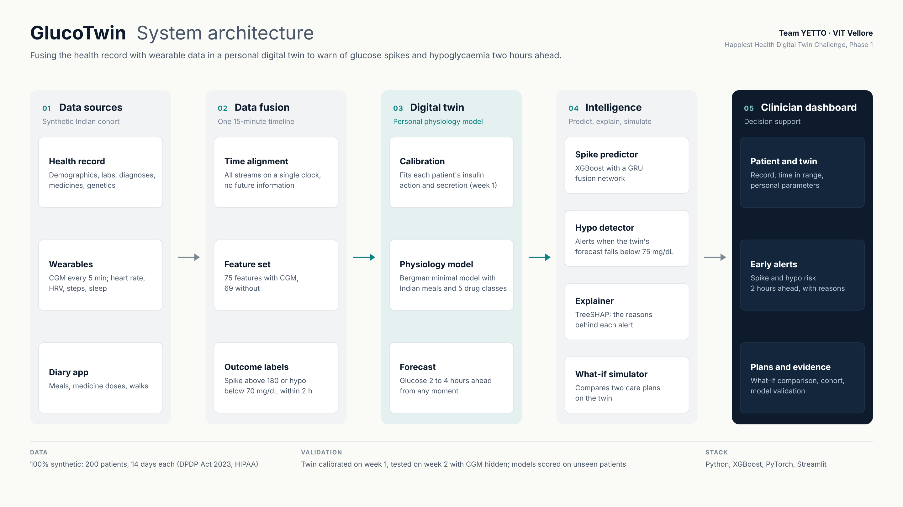

Five layers, one flow: **data sources** (synthetic Indian cohort) → **data fusion** (one snapshot
every 15 minutes) → **personal digital twin** (calibrated physiology model) → **intelligence**
(spike predictor, hypo detector, TreeSHAP explainer, what-if simulator) → **clinician dashboard**.
[PDF version](docs/architecture.pdf)

## Data (100% synthetic, privacy-safe)
No real patient data is used, in line with the DPDP Act 2023 and HIPAA.
`scripts/01_generate_data.py` creates an India-calibrated cohort of 200 virtual
Type 2 Diabetes patients with 14 days of 5-minute sensor data each.

| Stream | Files | Contents |
|---|---|---|
| EHR (static) | `data/ehr/patients.csv` | age, sex, region, BMI, waist, diabetes duration, family history, smoking, diet pattern, comorbidities |
| | `data/ehr/conditions.csv` | diagnoses with ICD-10 codes and onset dates |
| | `data/ehr/observations.csv` | HbA1c (2 visits), fasting glucose and insulin, HOMA-IR, lipids, kidney function, BP |
| | `data/ehr/medications.csv` | metformin, glimepiride, sitagliptin, dapagliflozin, insulin glargine, statin, telmisartan |
| | `data/ehr/genetics.csv` | TCF7L2 rs7903146 risk alleles, polygenic risk score |
| Wearables (dynamic) | `data/wearables/cgm.csv.gz` | CGM glucose every 5 min (with sensor lag, noise and dropouts) |
| | `data/wearables/smartwatch.csv.gz` | heart rate, HRV (RMSSD), steps, sleep stage every 5 min |
| | `data/wearables/sleep_nightly.csv` | nightly sleep duration, stages, efficiency, overnight HRV |
| App diary | `data/logs/meals.csv`, `medications.csv`, `activity.csv` | Indian meals with carbs, medicine doses (taken / missed), walks |
| Ground truth | `data/ground_truth/` | hidden physiology parameters, used only for evaluation |

### How the data is generated
The engine of the twin is a **Type 2 Diabetes glucose-insulin model** based on the
Bergman Minimal Model, extended with meal absorption, walking, sleep loss, the dawn
phenomenon and the effect of each diabetes medicine. Every patient has personal
values for insulin sensitivity and insulin secretion that follow from their health
record, so the two data streams tell one consistent physiological story.
India-specific features: regional Indian meals (idli, rice-sambar, roti-dal, biryani...),
the lower-BMI "thin-fat" diabetes phenotype, Asian BMI cut-offs, and commonly
prescribed Indian diabetes medicines.

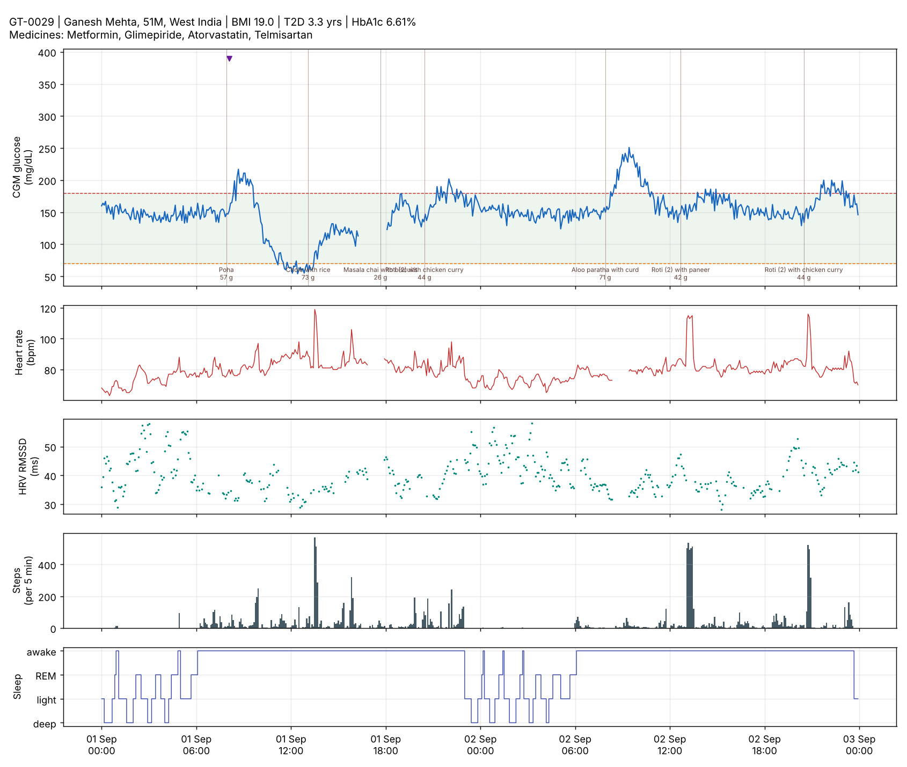

## Results
All evaluation is **by patient**: models are always tested on patients they have never
seen, like a new patient walking into a clinic.

### 1. Data fusion: when does the health record help? (XGBoost, 5-fold CV)
| | Spike AUPRC | Hypo AUPRC | Forecast error +30 min |
|---|---|---|---|
| CGM worn, without EHR | 0.85 | 0.31 | 9.5 mg/dL |
| CGM worn, **fused with EHR** | 0.85 | 0.33 | 9.5 mg/dL |
| Smartwatch only, without EHR | 0.79 | 0.06 | 20.9 mg/dL |
| Smartwatch only, **fused with EHR** | 0.83 | 0.20 | 13.4 mg/dL |
| EHR only | 0.76 | 0.14 | - |

While a CGM is worn, recent glucose already reveals most of what the record says. Without
a CGM (the everyday situation for most Indian patients, as one sensor costs about Rs 5,000
and lasts 14 days), fusing the record with smartwatch data **triples hypoglycaemia alert quality**
and cuts forecast error by 36%.

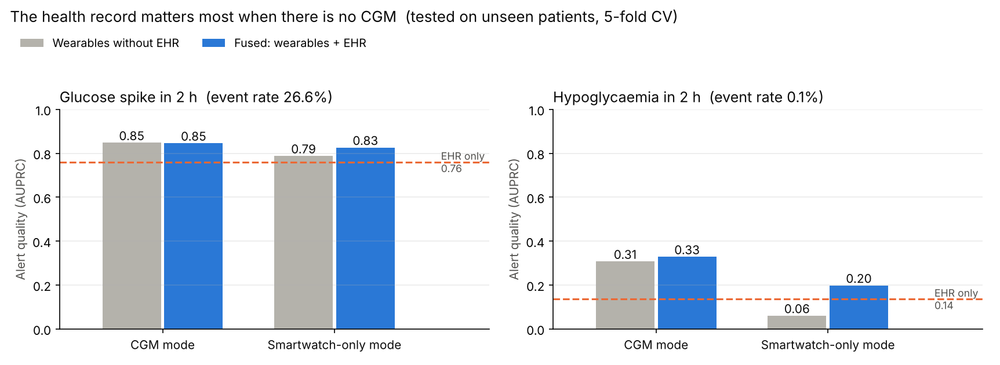

### 2. The calibrated digital twin
Each patient's hidden physiology (insulin sensitivity, pancreas function, liver glucose drive,
medicine response) is **calibrated from one week of CGM**, starting from estimates derived from
the health record (fasting insulin, fasting glucose, diabetes duration). In week 2 the CGM is
removed and the twin must reproduce glucose from the app diary and smartwatch alone.

| Twin | Week-2 error vs real CGM (median) |
|---|---|
| Population twin (average patient) | 17.9 mg/dL |
| EHR twin (health record only) | 13.0 mg/dL |
| **Calibrated twin (GlucoTwin)** | **8.8 mg/dL** |

The twin also recovers the hidden physiology (rank correlation with ground truth): liver glucose
drive 0.96, disposition index (SI x beta, a clinical severity measure) 0.93, insulin sensitivity 0.78.
Glucose data alone cannot separate insulin sensitivity from insulin secretion (a known property of
the minimal model), so we report their product.

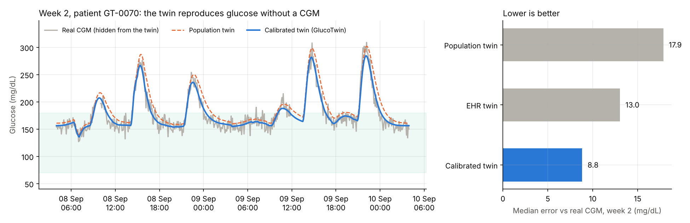
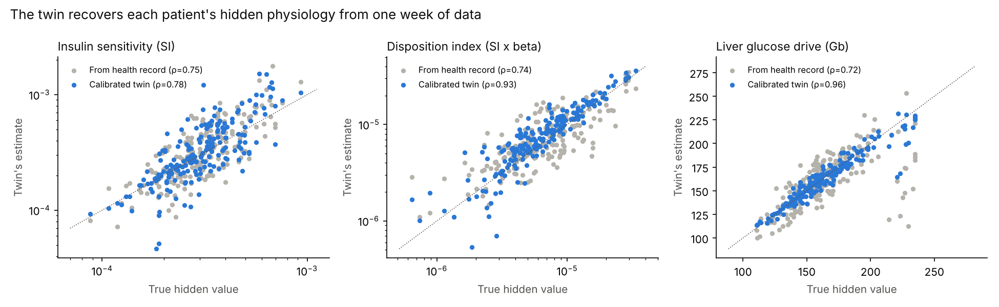

### 3. Hybrid model: physics twin + machine learning (week 2, CGM removed)
| | Spike AUPRC | Hypo AUPRC | Forecast error +60 min |
|---|---|---|---|
| Twin alone (physics, no ML) | 0.64 | **0.63** | 12.8 mg/dL |
| Smartwatch + EHR | 0.82 | 0.13 | 15.7 mg/dL |
| **Smartwatch + EHR + twin** | **0.86** | 0.26 | **12.8 mg/dL** |
| CGM + EHR (reference, CGM worn) | 0.84 | 0.19 | 13.2 mg/dL |

**A cheap smartwatch + the health record + a twin calibrated once on a CGM matches wearing a CGM.**
For rare hypoglycaemia (0.1% of moments), the physics twin alone beats every ML model: it needs no
training examples. So GlucoTwin uses:
- **Spike alerts**: hybrid XGBoost (twin forecast as input), explained with TreeSHAP
- **Hypo alerts**: the calibrated twin, alerting when its 2-hour forecast drops below 75 mg/dL
  (catches 91% of hypos in week 2)

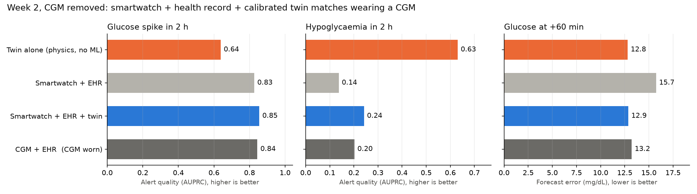

### 4. Explainability
Every spike alert lists its top reasons (exact TreeSHAP contributions), e.g.
*"HbA1c 8.1% (EHR) raises risk; time of day 21:30 raises risk"*. Without a CGM, the twin's forecast
carries 31% of the model's reasoning.

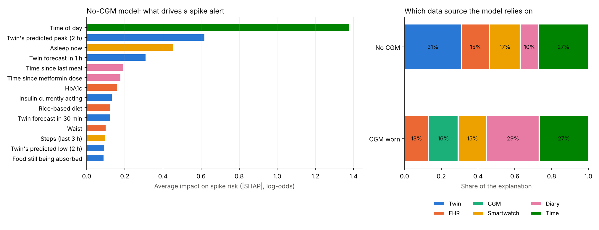

### 5. Deep fusion network
A two-branch neural network (2-layer GRU over the last 3 hours of sensor data + MLP over the health
record, multi-task heads for spike, hypo and glucose at +30/+60/+120 min), compared with XGBoost on
the same 50 unseen patients:

| | Spike AUPRC | Hypo AUPRC | MAE +30 | MAE +60 | MAE +120 |
|---|---|---|---|---|---|
| XGBoost | 0.86 | 0.35 | 9.6 | 13.1 | 18.2 |
| Deep fusion net | 0.84 | 0.46 | 9.8 | 13.4 | 19.0 |
| **Ensemble** | 0.86 | **0.53** | **9.3** | **12.8** | **17.9** |

Multi-task learning helps the rare hypo task borrow from the common tasks; the ensemble is best overall.

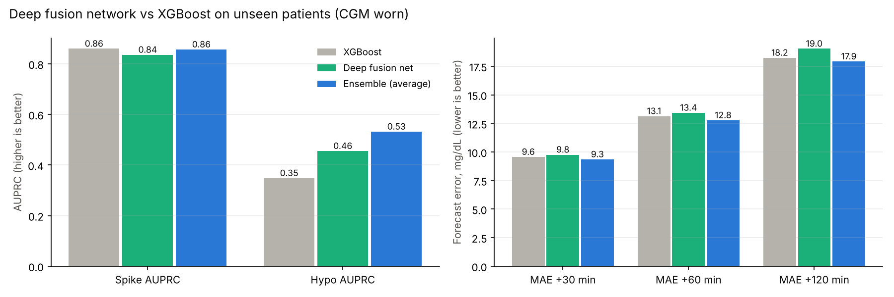

## Clinician dashboard
```bash
streamlit run app.py        # or double-click run_dashboard.bat on Windows
```
A Streamlit dashboard with six views, grouped by patient and population:

| View | What the doctor does there |
|---|---|
| Patient overview | Health record, labs, prescriptions, and time in range against the international CGM targets |
| Digital twin | The patient's calibrated parameters and 14 days of fused data: CGM, the twin's reconstruction, heart rate, HRV, steps, sleep |
| Predictive alerts | Spike and hypo risk for the next 2 hours at any moment, in CGM-worn or smartwatch-only mode, with TreeSHAP reasons |
| What-if simulator | Two care plans (meal, carbs, timing, walk, glimepiride) run on the twin from its saved state and compared |
| Cohort explorer | All 200 patients: filters, BMI vs HbA1c, disposition index, CSV export |
| Model evidence | Benchmarks read from `results/`, figures, ethics and limitations |

Every number is labelled as observed, predicted or simulated; what-if results are hypothetical
predictions, not treatment recommendations.

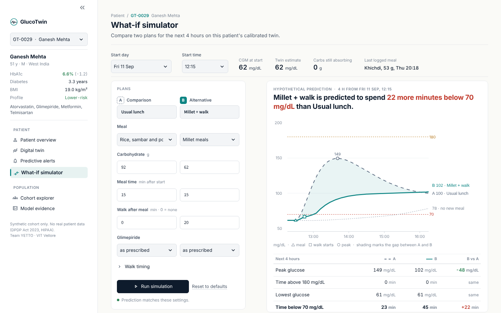
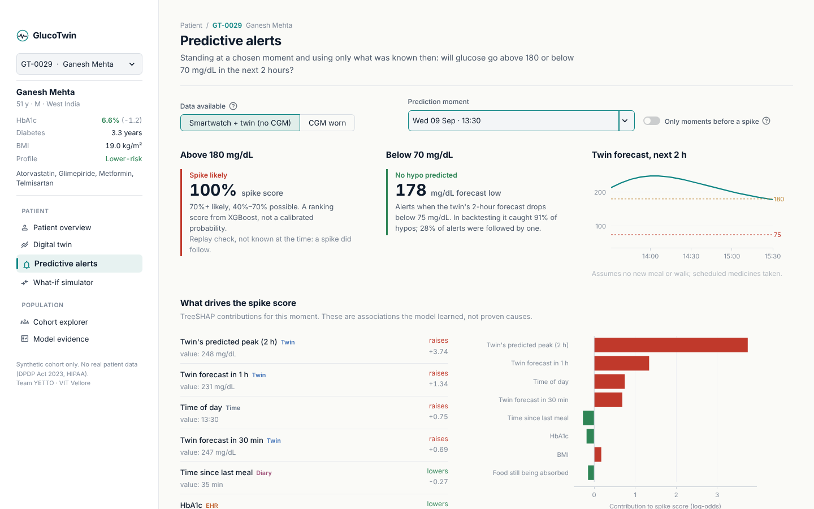
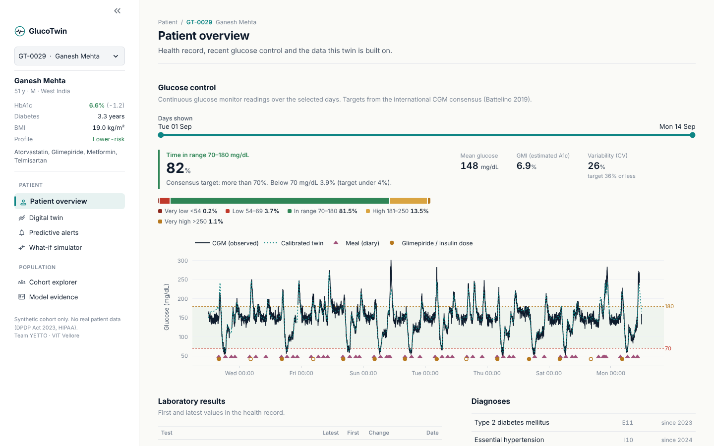

## Limitations (honest notes)
- **Synthetic data.** All patients are simulated. The twin's equations have the same structure as
  the simulator that generated the data, which flatters the twin; some parameters (glucose
  effectiveness, dawn effect, sleep sensitivity, adherence) are deliberately NOT fitted and differ per
  patient, but real-world errors would still be larger. Validation on real CGM data (e.g. OhioT1DM
  or a T2D cohort) is the next step.
- **Event counts.** Hypoglycaemia is rare (135 events in week 2), so hypo metrics are noisy; the hypo
  threshold was chosen on the same week-2 data it is reported on.
- **Known future inputs.** Twin forecasts assume no new meals or walks in the next 2 hours, and that
  scheduled medicines are taken as prescribed. Leakage audits confirm no future meal or dose is used.
- Decision support only, not a diagnostic device.

## How to run
Requires Python 3.10+. Run every command from the project root (the folder that contains `app.py`).

**Quick start: open the dashboard** (the generated data, twins and models are already in the repo):
```bash
pip install -r requirements.txt
python scripts/02_build_features.py         # builds data/processed (~1 min)
python scripts/05_hybrid_model.py           # twin features for week 2 (~4 min)
streamlit run app.py
```

**Full pipeline**, to regenerate everything from scratch, in order:
```bash
pip install -r requirements.txt
python scripts/01_generate_data.py          # synthetic cohort (~30 s)
python scripts/plot_patient.py GT-0029 --start-day 0 --days 2
python scripts/02_build_features.py         # fuse both streams (~1 min)
python scripts/03_train_baseline.py         # fusion ablation (~10-20 min)
python scripts/04_calibrate_twins.py        # calibrate 200 twins (~4 min)
python scripts/05_hybrid_model.py           # twin + ML, week 2 (~5-10 min)
python scripts/06_train_final_models.py     # dashboard models + explanations (~1 min)
python scripts/07_deep_fusion.py            # deep network vs XGBoost (~10-20 min)
streamlit run app.py                        # launch interactive clinician dashboard
```

## Project structure
```
glucotwin/            core library
  config.py           settings and clinical thresholds
  ehr_generator.py    synthetic Indian T2D health records
  lifestyle.py        Indian meals, walking, sleep, medicine doses
  physiology.py       T2D glucose-insulin model (extended Bergman Minimal Model)
  wearables.py        CGM and smartwatch signals
  features.py         data fusion: one row per patient-moment, 2-hour-ahead labels
  twin.py             per-patient twin calibration and forecasting
  hybrid.py           twin forecasts as ML features
  explain.py          TreeSHAP reasons in plain language
  deep.py             GRU + MLP deep fusion network
  whatif.py           what-if scenarios simulated on a patient's twin
  dashboard_data.py   data and model access for the dashboard
app.py                Streamlit clinician dashboard (six views)
ui_kit.py             dashboard design system: colours, type, chart styling
.streamlit/           dashboard theme
docs/                 architecture diagram, presentation, figures
scripts/              numbered pipeline steps (run in order)
data/                 generated data (EHR, wearables, app logs, twins, ground truth)
models/               trained models + model card
results/              metrics (JSON) and charts
```

## Technical stack
| Part | Tools |
|---|---|
| Data generation and physiology | Python, NumPy, SciPy, pandas |
| Twin calibration | Bergman Minimal Model (extended), Cross-Entropy Method optimiser |
| Machine learning | XGBoost, scikit-learn, PyTorch (GRU deep fusion network) |
| Explainability | TreeSHAP (XGBoost exact feature contributions) |
| Charts | Matplotlib, Plotly |
| Dashboard | Streamlit, Plotly (patient overview, digital twin, predictive alerts, what-if simulator, cohort, evidence) |

## License
MIT License. See [LICENSE](LICENSE).
